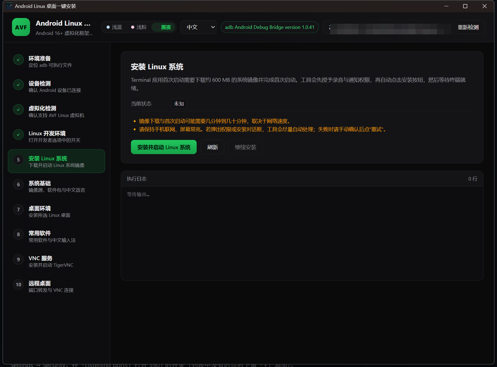
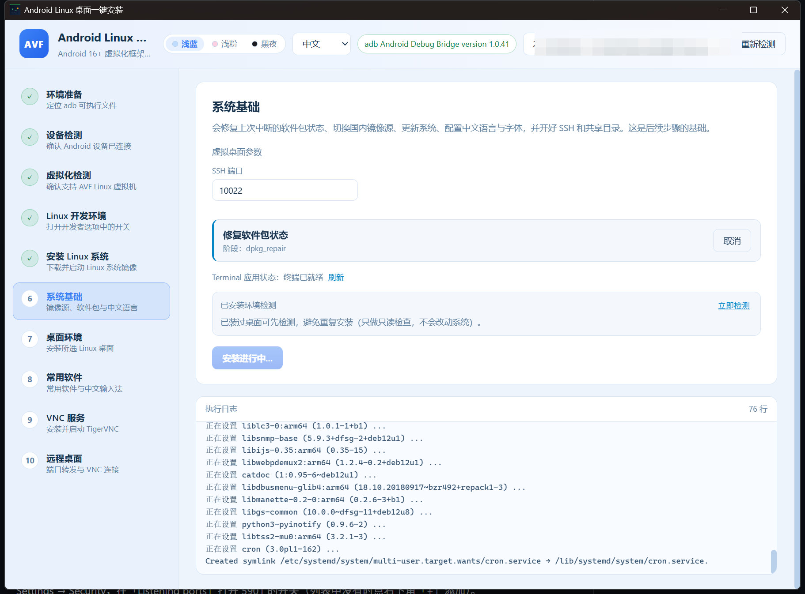

# AndroidCreateLinuxGUITool

Turn an Android 16+ phone that supports **AVF (Android Virtualization Framework)** into a usable Debian desktop —
with a Windows or Linux GUI that drives everything over ADB. No commands typed on the phone.

**English** | [简体中文](README.zh-CN.md)



<p align="center"><em>11-step workflow: device detection → Linux VM → system base → desktop → apps → VNC → remote desktop → audio</em></p>



<p align="center"><em>Live log from inside the VM, with per-stage progress and cancel/retry</em></p>

## Highlights

- **11 guided steps** — adb detection, device check, AVF check, Linux developer environment, system image, four independent install stages, a remote desktop launcher and an optional desktop-audio step.
- **Fully automatic install** — opens the Linux development environment switch (English and Chinese system UI), installs the Terminal image when needed, and runs an idempotent setup script inside the VM.
- **4 separate install stages** — system base / desktop / common apps / VNC service. If one stage fails you only rerun that stage; dpkg interrupted states are repaired automatically.
- **Offline-ready bundled assets** — on Windows, adb and the TigerVNC viewer ship inside the app; the AVNC APK is bundled on every platform, so nothing has to be downloaded behind a firewall. On Linux the app uses the distro `adb` and `tigervnc-viewer` packages (declared as deb dependencies).
- **7 UI languages** (Chinese, English, German, French, Spanish, Japanese, Korean) and 3 themes (light blue, light pink, near-black).
- **Real-time progress, no screen scraping** — the script writes markers into a log file in the shared folder; the PC polls it over adb.

## How it works

```text
Windows/Linux GUI ──adb push──▶ phone shared storage ──virtiofs──▶ /mnt/shared inside Debian
      ▲                                                              │
      └──────────── adb shell cat acl_install.log ◀──────────────────┘
```

The GUI renders `install-desktop.sh`, injects your options, pushes it to the phone's shared folder and
executes it in the Terminal app. Progress (`@@STEP:` / `@@RESULT:`) and failures are read back from
`acl_install.log`, so the UI never has to read the screen.

## The 11 steps

| # | Step | What it does |
| --- | --- | --- |
| 1 | Environment | Locates `adb` (bundled on Windows, system package on Linux; manual path as fallback) |
| 2 | Device | Finds a connected, authorized device; guides you when none is present |
| 3 | Virtualization | Checks `virtualization_framework` and `vm info`; unsupported models are reported early |
| 4 | Linux developer environment | Opens the "Linux development environment" switch in Developer options (English + Chinese UI), explains enterprise-policy / Secure Folder restrictions |
| 5 | Install Linux system | Launches the Terminal app, installs the system image (~600 MB) when missing, grants microphone/notification permissions |
| 6 | System base | Repairs interrupted dpkg state, switches to a China mirror (optional), `apt update/upgrade`, Chinese locale + CJK fonts, SSH on port 10022, shared-folder mount |
| 7 | Desktop environment | Installs the desktop you pick: XFCE (default), GNOME, KDE Plasma, MATE, Cinnamon, LXQt, LXDE, GNOME Flashback |
| 8 | Common apps | Optional app suite and the Fcitx5 Chinese input method |
| 9 | VNC service | Installs and configures TigerVNC, writes the password file, starts the `acl-vnc.service` session on a dedicated display (`:2`+, so it never competes with the Terminal's Weston/Xwayland `:1`) on port 5901, and verifies the desktop session actually took over |
| 10 | Remote desktop | Starts the phone-side relay, runs `adb forward`, verifies the VNC password handshake, opens the TigerVNC viewer (bundled on Windows, `tigervnc-viewer` on Linux), and can install AVNC on the phone. If the VNC service was stopped, it is restarted automatically |
| 11 | Desktop audio | Detects whether the VM has a real speaker; otherwise configures PulseAudio streaming and installs the Simple Protocol Player on the phone |

Stages 6–9 are the old single "install desktop" step, split so each one is short, restartable and easy to debug.

## Requirements

- Windows 10/11, or Linux (built and tested on Debian 13; `amd64` and `arm64` deb packages are provided)
- On Windows, Android Platform Tools are **not** required — a working `adb` is bundled, but you can point the tool at your own `adb.exe`
- On Linux, install `adb` and `tigervnc-viewer`; the deb pulls both in automatically (`sudo apt install adb tigervnc-viewer` for source builds)
- Phone: Android 16+, AVF capable, USB debugging enabled
- Phone must stay **unlocked and awake** while installing: command injection relies on the soft keyboard, and a locked screen silently drops input
- ~2 GB of free space on the phone for Debian packages

## Quick start

1. Connect the phone, unlock it, keep USB debugging on.
2. Install and launch:

   - Windows: run the release build `src-tauri\target\release\android-create-linux-gui-tool.exe`
   - Linux: `sudo apt install ./release/deb/AndroidCreateLinuxGUITool_0.1.0_amd64.deb`
     (use the `arm64` package on ARM machines), then start **AndroidCreateLinuxGUITool** from the app menu
     or run `android-create-linux-gui-tool`

3. Walk through the steps on the left; each step unlocks the next one.

Choosing "yes" to the China prompt in step 6 switches APT to the TUNA mirror and enables the Chinese
locale and input method; choosing "no" keeps the official Debian sources and an English environment.

### Step 6–9 notes

- Every stage is idempotent. "Cancel" stops the run; pressing install again continues from the same stage.
- Detected components (desktop / apps / IME / VNC / SSH) are shown before installing, so a second run can skip finished work.
- Defaults: VNC password `linux`, fixed VNC port `5901`, geometry `1920x1080`, SSH port `10022`.
  The VNC X server picks a free display starting at `:2`; display `:1` is left to the Terminal's own desktop.

### Step 10 notes

- "Allow port and open TigerVNC" first checks whether port 5901 is already served, otherwise starts a phone-side
  `nc` relay on a separate phone port (for example 15901) and maps PC `5901` to it with `adb forward`. This bypasses
  stale Terminal forwards such as the "listening but not forwarding" socket seen on Redmi K Pad.
  It then performs a real VncAuth handshake and starts the TigerVNC viewer (bundled on Windows, system package on Linux) with the address and password pre-filled.
- If the VNC service was stopped (for example after a VM restart), the tool restarts `acl-vnc.service` and retries.
  If it cannot, it tells you to unlock the phone and rerun the "VNC service" step.
- "Install AVNC" uses the bundled AVNC APK first and only falls back to GitHub if that fails.
  Connect with `127.0.0.1:5901` and the VNC password from step 9 (username is optional, `droid` also works).

## Build from source

### Windows

Prerequisites: Node.js 18+, stable Rust, WebView2 (included in Windows 10/11), MSVC build tools and the Windows SDK.

```bash
npm install

# dev with hot reload
npm run tauri:dev

# release build
npm run build
cd src-tauri
cargo build --release --features custom-protocol
```

Output: `src-tauri/target/release/android-create-linux-gui-tool.exe`.

### Linux (deb)

Prerequisites: Node.js 18+, stable Rust and the Tauri system libraries.

```bash
sudo apt install build-essential pkg-config libssl-dev libwebkit2gtk-4.1-dev \
  libgtk-3-dev librsvg2-dev libayatana-appindicator3-dev
npm install
npm run tauri:build -- --bundles deb
```

Output: `src-tauri/target/release/bundle/deb/AndroidCreateLinuxGUITool_0.1.0_amd64.deb`.
The package declares `adb`, `tigervnc-viewer`, `xdg-utils`, `libwebkit2gtk-4.1-0` and `libgtk-3-0` as dependencies,
so a plain `sudo apt install ./<package>.deb` is enough.

To cross-build the **arm64** package on an x86_64 Debian host:

```bash
rustup target add aarch64-unknown-linux-gnu
sudo apt install crossbuild-essential-arm64 libwebkit2gtk-4.1-dev:arm64

PKG_CONFIG_ALLOW_CROSS=1 \
PKG_CONFIG_LIBDIR=/usr/lib/aarch64-linux-gnu/pkgconfig:/usr/share/pkgconfig \
CC_aarch64_unknown_linux_gnu=aarch64-linux-gnu-gcc \
CARGO_TARGET_AARCH64_UNKNOWN_LINUX_GNU_LINKER=aarch64-linux-gnu-gcc \
RUSTFLAGS="-L/usr/lib/aarch64-linux-gnu -C link-arg=-Wl,-rpath-link,/usr/lib/aarch64-linux-gnu" \
npm run tauri:build -- --target aarch64-unknown-linux-gnu --bundles deb
```

Output: `src-tauri/target/aarch64-unknown-linux-gnu/release/bundle/deb/AndroidCreateLinuxGUITool_0.1.0_arm64.deb`.
The `:arm64` development libraries replace their `amd64` counterparts, so reinstall `libwebkit2gtk-4.1-dev:amd64`
before building the x64 package again. Prebuilt packages live in `release/deb/`.

## Command line

| Argument | Purpose |
| --- | --- |
| `--diagnose` / `--diagnose-json` | Print a device / AVF / developer-options report |
| `--selftest` | Exercise the core chain on a real device |
| `--install` | Run the installer without the GUI |
| `--stage=base\|desktop\|apps\|vncsvc` | With `--install`: run a single stage |
| `--desktop=xfce` | With `--install`: pick the desktop |
| `--official-source` | With `--install`: Debian official sources + English locale |
| `--no-apps` | With `--install`: skip the common app suite |
| `--port=5901` | Establish the phone relay + `adb forward`, verify VNC auth, and open the TigerVNC viewer |
| `--exec="<command>"` | Run one command in the VM terminal and read the output |

```powershell
.\android-create-linux-gui-tool.exe --diagnose
.\android-create-linux-gui-tool.exe --install --stage=base
.\android-create-linux-gui-tool.exe --exec="uname -a"
```

On Linux the same binary is installed as `android-create-linux-gui-tool`; use `./android-create-linux-gui-tool --diagnose`
or `/usr/bin/android-create-linux-gui-tool --install --stage=base`.

## Project structure

```text
├─ src/                        # Vue 3 frontend
│  ├─ App.vue                  # 11-step workflow UI
│  ├─ api.ts                   # Tauri commands / events
│  ├─ i18n.ts                  # 7 UI languages
│  ├─ types.ts                 # shared types
│  └─ components/              # log panel, modal dialog
├─ src-tauri/
│  ├─ src/
│  │  ├─ adb.rs                # adb wrapper (locate, shell, push, forward)
│  │  ├─ apk.rs                # bundled APK install / launch / query
│  │  ├─ audio.rs              # desktop audio detection and streaming setup
│  │  ├─ detect.rs             # device and AVF detection
│  │  ├─ devopts.rs            # developer options / Linux environment switch
│  │  ├─ disk.rs               # VM disk resizing
│  │  ├─ terminal.rs           # drives the Terminal app (focus, type, tap)
│  │  ├─ installer.rs          # per-stage orchestration and log polling
│  │  ├─ relay.rs              # phone-side nc relay + guest discovery/verification
│  │  ├─ ports.rs              # Terminal port-control fallback
│  │  ├─ vnc.rs                # VNC probe/auth, viewer launch, AVNC
│  │  ├─ uia.rs                # uiautomator helpers
│  │  ├─ util.rs               # data dir, bundled files, detached launch
│  │  ├─ commands.rs           # Tauri commands exposed to the frontend
│  │  └─ lib.rs / main.rs      # entry point and CLI modes
│  └─ resources/
│     ├─ install-desktop.sh    # staged setup script executed inside the VM
│     ├─ detect-installed.sh   # read-only environment probe
│     ├─ adb.exe               # bundled adb (Windows only)
│     ├─ vncviewer.exe         # bundled TigerVNC viewer (Windows only)
│     └─ avnc.apk              # bundled Android VNC client
├─ docs/images/                # README screenshots
├─ release/deb/                # prebuilt amd64 / arm64 deb packages
└─ shots/                      # capture helpers
```

Linux bundling settings (deb target and runtime dependencies) live in
[`src-tauri/tauri.linux.conf.json`](src-tauri/tauri.linux.conf.json) and are merged automatically on Linux builds.

## Troubleshooting

**"The command does not seem to run in the terminal" / retry loop**
Input injection needs the on-screen keyboard. Keep the phone unlocked and tap the Terminal command line once, then retry.

**VNC connects but the desktop is black**
The script forces X11 through `~/.xsessionrc` and starts VNC on a dedicated display (`:2`+). Re-run
`bash /mnt/shared/acl_install.sh vncsvc` in the Terminal; stale window-manager sessions on the VNC display are cleaned automatically.

**VNC service keeps stopping / "VNC server unreachable"**
The tool auto-starts `acl-vnc.service` when you press the remote-desktop button. If it cannot (phone locked,
Terminal not ready), unlock the phone, open Terminal once, and re-run the "VNC service" step.

**Install stopped at "Package configuration"**
Older builds could stall in debconf. Current builds pass `DEBIAN_FRONTEND=noninteractive` through sudo and preseed keyboard-configuration; make sure you run the latest executable.

**Port forwarding fails**
Replug USB and check `adb devices`. The tool normally uses its own phone-side relay and only falls back to
Terminal → ⋮ → Settings → Security → Listening ports if the relay cannot start.

**Device is reported as enterprise-managed**
HyperOS/MIUI sometimes prints `no owners`; recent builds match this case-insensitively.

**Linux: "adb executable not found"**
The Linux build has no bundled adb. Install it with `sudo apt install adb` (the deb already depends on it) or point
the tool at another binary in step 1.

**Linux: remote desktop cannot find a viewer**
Install TigerVNC: `sudo apt install tigervnc-viewer`. The tool looks for `vncviewer` / `xtigervncviewer` in
`/usr/bin`, `/usr/local/bin`, `/snap/bin` and the Flatpak export directory.

## Disclaimer

The tool changes developer options over adb and restarts services inside the VM. Use it at your own risk;
the installation needs roughly 2 GB of phone storage and a long download.
