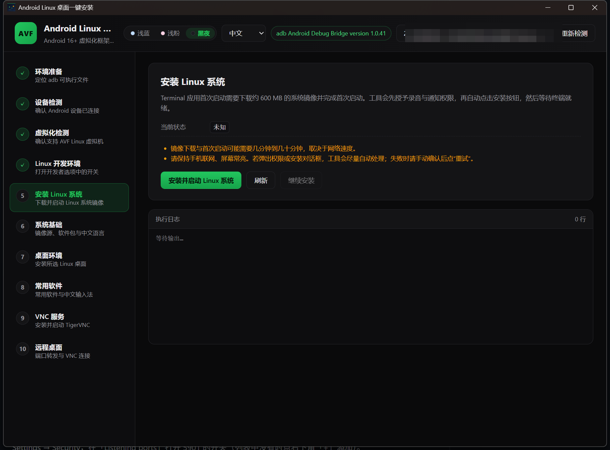
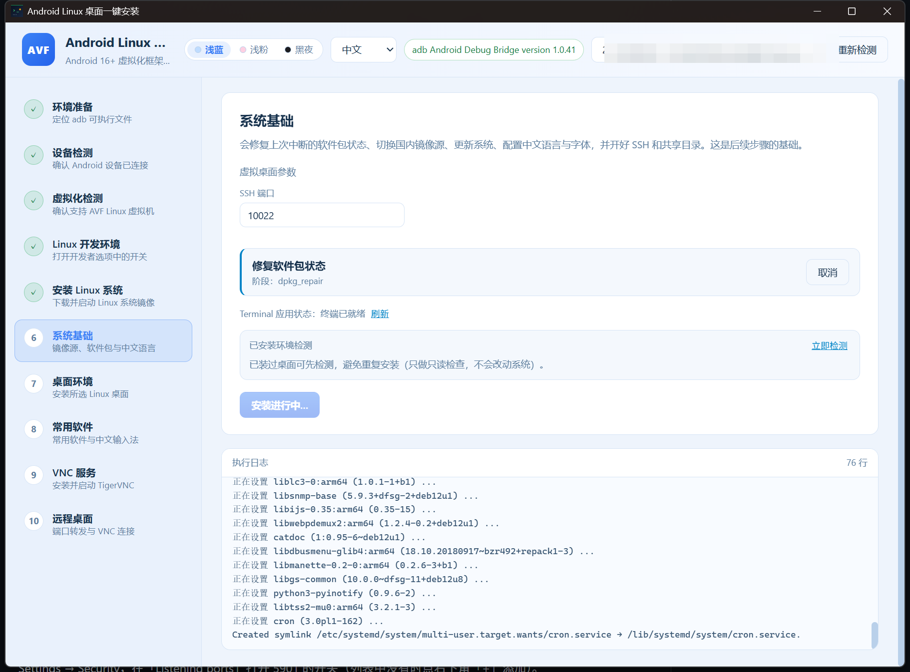

# AndroidCreateLinuxGUITool

Turn an Android 16+ phone that supports **AVF (Android Virtualization Framework)** into a usable Debian desktop —
with a Windows GUI that drives everything over ADB. No commands typed on the phone.

**English** | [简体中文](README.zh-CN.md)



<p align="center"><em>10-step workflow: device detection → Linux VM → system base → desktop → apps → VNC → remote desktop</em></p>



<p align="center"><em>Live log from inside the VM, with per-stage progress and cancel/retry</em></p>

## Highlights

- **10 guided steps** — adb detection, device check, AVF check, Linux developer environment, system image, then four independent install stages and a remote desktop launcher.
- **Fully automatic install** — opens the Linux development environment switch (English and Chinese system UI), installs the Terminal image when needed, and runs an idempotent setup script inside the VM.
- **4 separate install stages** — system base / desktop / common apps / VNC service. If one stage fails you only rerun that stage; dpkg interrupted states are repaired automatically.
- **Offline-ready bundled assets** — adb, TigerVNC viewer and the AVNC APK ship inside the app, so nothing has to be downloaded behind a firewall.
- **7 UI languages** (Chinese, English, German, French, Spanish, Japanese, Korean) and 3 themes (light blue, light pink, near-black).
- **Real-time progress, no screen scraping** — the script writes markers into a log file in the shared folder; the PC polls it over adb.

## How it works

```text
Windows GUI ──adb push──▶ phone shared storage ──virtiofs──▶ /mnt/shared inside Debian
      ▲                                                              │
      └──────────── adb shell cat acl_install.log ◀──────────────────┘
```

The GUI renders `install-desktop.sh`, injects your options, pushes it to the phone's shared folder and
executes it in the Terminal app. Progress (`@@STEP:` / `@@RESULT:`) and failures are read back from
`acl_install.log`, so the UI never has to read the screen.

## The 10 steps

| # | Step | What it does |
| --- | --- | --- |
| 1 | Environment | Locates `adb` (bundled copy first, manual path as fallback) |
| 2 | Device | Finds a connected, authorized device; guides you when none is present |
| 3 | Virtualization | Checks `virtualization_framework` and `vm info`; unsupported models are reported early |
| 4 | Linux developer environment | Opens the "Linux development environment" switch in Developer options (English + Chinese UI), explains enterprise-policy / Secure Folder restrictions |
| 5 | Install Linux system | Launches the Terminal app, installs the system image (~600 MB) when missing, grants microphone/notification permissions |
| 6 | System base | Repairs interrupted dpkg state, switches to a China mirror (optional), `apt update/upgrade`, Chinese locale + CJK fonts, SSH on port 10022, shared-folder mount |
| 7 | Desktop environment | Installs the desktop you pick: XFCE (default), GNOME, KDE Plasma, MATE, Cinnamon, LXQt, LXDE, GNOME Flashback |
| 8 | Common apps | Optional app suite and the Fcitx5 Chinese input method |
| 9 | VNC service | Installs and configures TigerVNC, writes the password file, starts the `:1` session (port 5901) and verifies the window manager actually took over |
| 10 | Remote desktop | Allows port 5901 in Terminal → ⋮ → Settings → Security, runs `adb forward`, opens TigerVNC, and can install AVNC on the phone |

Stages 6–9 are the old single "install desktop" step, split so each one is short, restartable and easy to debug.

## Requirements

- Windows 10/11 (bundled TigerVNC viewer and AVNC are Windows/Android specific)
- Android Platform Tools are **not** required — a working `adb` is bundled, but you can point the tool at your own `adb.exe`
- Phone: Android 16+, AVF capable, USB debugging enabled
- Phone must stay **unlocked and awake** while installing: command injection relies on the soft keyboard, and a locked screen silently drops input
- ~2 GB of free space on the phone for Debian packages

## Quick start

1. Connect the phone, unlock it, keep USB debugging on.
2. Run the release build:

   ```text
   src-tauri\target\release\android-create-linux-gui-tool.exe
   ```

3. Walk through the steps on the left; each step unlocks the next one.

Choosing "yes" to the China prompt in step 6 switches APT to the TUNA mirror and enables the Chinese
locale and input method; choosing "no" keeps the official Debian sources and an English environment.

### Step 6–9 notes

- Every stage is idempotent. "Cancel" stops the run; pressing install again continues from the same stage.
- Detected components (desktop / apps / IME / VNC / SSH) are shown before installing, so a second run can skip finished work.
- Defaults: VNC password `linux`, display `:1` → port `5901`, geometry `1920x1080`, SSH port `10022`.

### Step 10 notes

- "Allow port and open TigerVNC" performs the port release, `adb forward tcp:5901`, then starts the bundled
  viewer and fills in the address and password.
- "Install AVNC" uses the bundled AVNC APK first and only falls back to GitHub if that fails.
  Connect with `127.0.0.1:5901` and the VNC password from step 9 (username is optional, `droid` also works).

## Build from source

Prerequisites: Node.js 18+, stable Rust, WebView2 (included in Windows 10/11), MSVC build tools and the Windows SDK.

```bash
npm install

# dev with hot reload
npm run tauri:dev

# release build
npm run build
cd src-tauri
cargo build --release --features custom-protocol
```

Output: `src-tauri/target/release/android-create-linux-gui-tool.exe`.

## Command line

| Argument | Purpose |
| --- | --- |
| `--diagnose` / `--diagnose-json` | Print a device / AVF / developer-options report |
| `--selftest` | Exercise the core chain on a real device |
| `--install` | Run the installer without the GUI |
| `--stage=base\|desktop\|apps\|vncsvc` | With `--install`: run a single stage |
| `--desktop=xfce` | With `--install`: pick the desktop |
| `--official-source` | With `--install`: Debian official sources + English locale |
| `--no-apps` | With `--install`: skip the common app suite |
| `--fetch-viewer` | Download the portable TigerVNC viewer only |
| `--port=5901` | Release the port, `adb forward`, and try to open TigerVNC |
| `--exec="<command>"` | Run one command in the VM terminal and read the output |

```powershell
.\android-create-linux-gui-tool.exe --diagnose
.\android-create-linux-gui-tool.exe --install --stage=base
.\android-create-linux-gui-tool.exe --exec="uname -a"
```

## Project structure

```text
├─ src/                        # Vue 3 frontend
│  ├─ App.vue                  # 10-step workflow UI
│  ├─ api.ts                   # Tauri commands / events
│  ├─ i18n.ts                  # 7 UI languages
│  ├─ types.ts                 # shared types
│  └─ components/              # log panel, modal dialog
├─ src-tauri/
│  ├─ src/
│  │  ├─ adb.rs                # adb wrapper (locate, shell, push, forward)
│  │  ├─ detect.rs             # device and AVF detection
│  │  ├─ devopts.rs            # developer options / Linux environment switch
│  │  ├─ terminal.rs           # drives the Terminal app (focus, type, tap)
│  │  ├─ installer.rs          # per-stage orchestration and log polling
│  │  ├─ ports.rs              # VNC port release
│  │  ├─ vnc.rs                # TigerVNC launch, AVNC install, adb forward
│  │  ├─ commands.rs           # Tauri commands exposed to the frontend
│  │  └─ lib.rs / main.rs      # entry point and CLI modes
│  └─ resources/
│     ├─ install-desktop.sh    # staged setup script executed inside the VM
│     ├─ detect-installed.sh   # read-only environment probe
│     ├─ adb.exe               # bundled adb
│     ├─ vncviewer.exe         # bundled TigerVNC viewer
│     └─ avnc.apk              # bundled Android VNC client
├─ docs/images/                # README screenshots
└─ shots/                      # capture helpers
```

## Troubleshooting

**"The command does not seem to run in the terminal" / retry loop**
Input injection needs the on-screen keyboard. Keep the phone unlocked and tap the Terminal command line once, then retry.

**VNC connects but the desktop is black**
The script forces X11 through `~/.xsessionrc`. Re-run `bash /mnt/shared/acl_install.sh vncsvc` in the Terminal; stale window-manager sessions are cleaned automatically.

**Install stopped at "Package configuration"**
Older builds could stall in debconf. Current builds pass `DEBIAN_FRONTEND=noninteractive` through sudo and preseed keyboard-configuration; make sure you run the latest executable.

**Port forwarding fails**
Replug USB and check `adb devices`. You can also enable port 5901 manually: Terminal → ⋮ → Settings → Security → Listening ports (use the `+` button if it is not listed).

**Device is reported as enterprise-managed**
HyperOS/MIUI sometimes prints `no owners`; recent builds match this case-insensitively.

## Disclaimer

The tool changes developer options over adb and restarts services inside the VM. Use it at your own risk;
the installation needs roughly 2 GB of phone storage and a long download.
