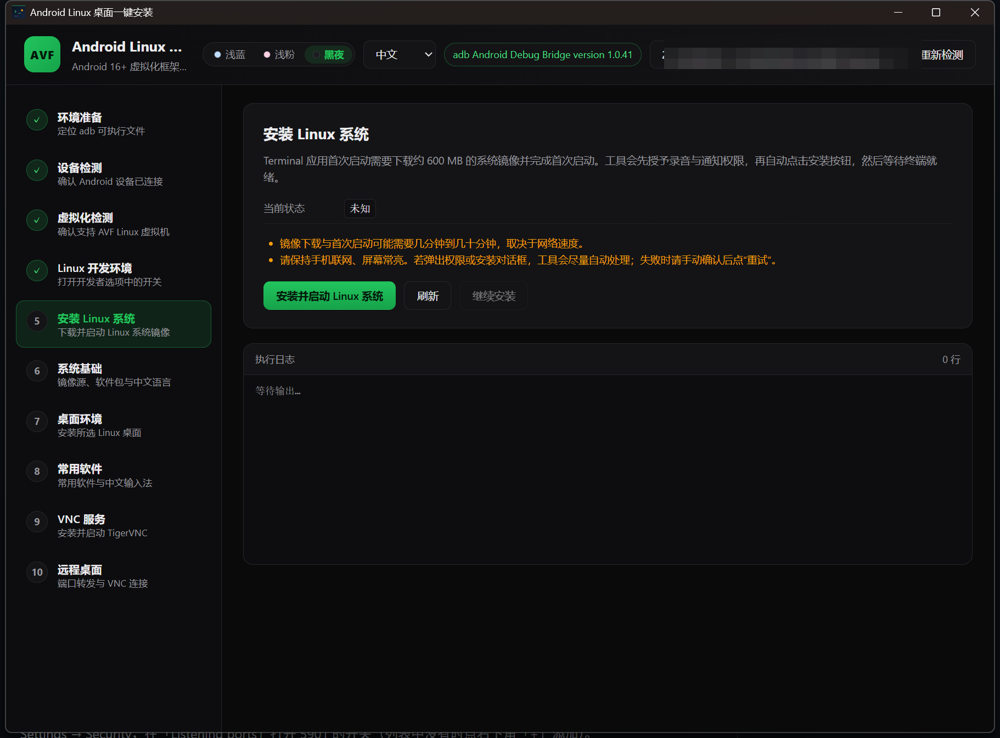
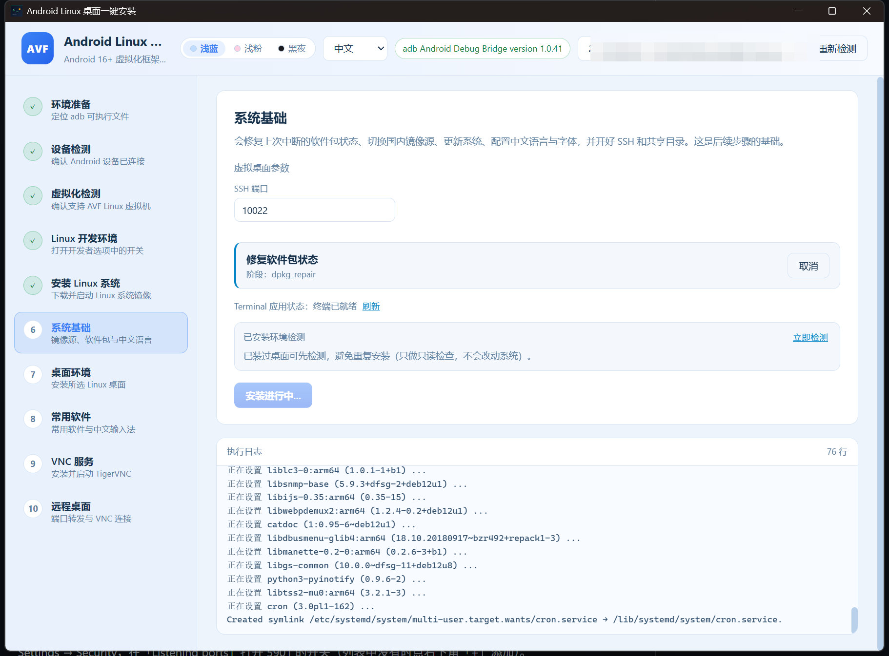

# AndroidCreateLinuxGUITool

在支持 **AVF（Android 虚拟化框架）的 Android 16+ 手机**上一键装好 Debian 桌面环境，
并用 Windows / Linux / macOS 图形界面全程遥控，不需要在手机上手动敲命令。

[English](README.md) | **简体中文**



<p align="center"><em>11 步工作流：设备检测 → Linux 虚拟机 → 系统基础 → 桌面环境 → 常用软件 → VNC 服务 → 桌面音频 → 远程桌面（可一键直达）</em></p>



<p align="center"><em>虚拟机内的实时日志，按阶段显示进度，可随时取消或重试</em></p>

## 功能亮点

- **11 个引导步骤**（侧栏按「准备 / 安装 / 使用」分组）：adb 检测、设备检测、AVF 检测、Linux 开发环境、系统镜像，随后是 4 个独立的安装阶段、桌面音频和远程桌面；远程桌面固定在最后，顶栏与侧栏都有一键直达入口。
- **全自动安装**：自动打开开发者选项里的「Linux 开发环境」开关（兼容中英文系统界面），必要时自动安装 Terminal 系统镜像，并在虚拟机内执行幂等安装脚本。
- **4 个独立安装阶段**：「系统基础 / 桌面环境 / 常用软件 / VNC 服务」分开执行，某一步失败只需重跑该步骤；上次中断留下的 dpkg 异常会自动修复。
- **离线可用**：Windows 版内置 adb 与 TigerVNC 查看器，AVNC 安装包所有平台都内置，网络受限时也能用；Linux 版使用发行版的 `adb` 与 `tigervnc-viewer`（已写进 deb 依赖）；macOS 版使用系统 `adb`（Homebrew / Android SDK），未安装 TigerVNC 时自动调用系统「屏幕共享」。
- **7 种界面语言**（中、英、德、法、西、日、韩）与 3 套主题（浅蓝、浅粉、黑夜）。
- **真实进度回传**：脚本把标记写入共享目录的日志，PC 端通过 adb 轮询读取，无需识别屏幕。

## 工作原理

```text
Windows / Linux 图形界面 ──adb push──▶ 手机共享存储 ──virtiofs──▶ Debian 内的 /mnt/shared
        ▲                                                        │
        └──────────── adb shell cat acl_install.log ◀────────────┘
```

工具把 `install-desktop.sh` 渲染好（注入界面选项），推送到手机共享目录，再在 Terminal 应用中执行。
进度（`@@STEP:` / `@@RESULT:`）和失败原因写入 `acl_install.log`，界面据此更新，不依赖 OCR 或读屏。

## 十一个步骤

| # | 步骤 | 内容 |
| --- | --- | --- |
| 1 | 环境准备 | 定位 `adb`：Windows 优先使用内置版本，Linux 使用系统 adb，找不到时可手动指定 |
| 2 | 设备检测 | 检测已连接且已授权 USB 调试的设备，未连接时弹窗引导 |
| 3 | 虚拟化检测 | 检查 `virtualization_framework` 与 `vm info`，不支持的机型提前提示 |
| 4 | Linux 开发环境 | 在开发者选项中自动找到并打开「Linux 开发环境」开关（中英文界面），遇到企业策略 / 安全文件夹等限制时给出说明 |
| 5 | 安装 Linux 系统 | 唤起 Terminal，按需自动安装系统镜像（约 600 MB），并授予录音、通知权限 |
| 6 | 系统基础 | 修复 dpkg 中断状态、切换国内镜像源（可选）、`apt update/upgrade`、中文语言与中文字体、SSH（10022）、挂载共享目录 |
| 7 | 桌面环境 | 安装所选桌面：XFCE（默认）、GNOME、KDE Plasma、MATE、Cinnamon、LXQt、LXDE、GNOME Flashback |
| 8 | 常用软件 | 可选安装常用软件套件与 Fcitx5 中文输入法 |
| 9 | VNC 服务 | 安装配置 TigerVNC、生成密码文件、在**独立显示号**（从 `:2` 起，避免和 Terminal 自带的 Weston/Xwayland `:1` 抢占）上启动 `acl-vnc.service`（端口 5901），并校验桌面会话确实接管 |
| 10 | 桌面音频 | 检测虚拟机是否有真实扬声器；没有则配置 PulseAudio 串流，必要时自动建立手机端中继，并在手机上安装 Simple Protocol Player |
| 11 | 远程桌面（可直达） | 建立手机端中继、`adb forward`、完成 VNC 密码握手，打开 TigerVNC 查看器（Windows 内置、Linux 使用系统包、macOS 用系统「屏幕共享」）；VNC 服务没起来时会自动重启；也可为手机安装 AVNC |

第 6–9 步就是原来单一的「安装桌面环境」，拆开之后每一步都更短、可单独重跑、也更容易定位问题。

## 环境要求

- Windows 10/11、Linux（在 Debian 13 上构建和验证，提供 `amd64` 与 `arm64` 两种 deb 包），或 macOS 10.15+
- Windows 版不需要单独安装 Android Platform Tools：工具内置 `adb`，也可指定自己的 `adb.exe`
- Linux 版需要 `adb` 与 `tigervnc-viewer`：deb 依赖已自动拉取；从源码运行时执行 `sudo apt install adb tigervnc-viewer`
- macOS 版需要 `adb`：`brew install --cask android-platform-tools`；远程桌面可直接使用系统「屏幕共享」，无需额外安装 TigerVNC
- 手机：Android 16+，支持 AVF，已开启 USB 调试
- 安装时手机需保持**亮屏、解锁**：自动输入依赖软键盘，锁屏会让输入被系统丢弃
- 手机至少预留约 2 GB 存储空间

## 快速开始

1. 连接手机并解锁，确认 USB 调试已开启。
2. 安装并启动：

   - Windows：运行发布版 `src-tauri\target\release\android-create-linux-gui-tool.exe`
   - Linux：`sudo apt install ./release/deb/AndroidCreateLinuxGUITool_0.1.0_amd64.deb`
     （ARM 机器改用 `arm64` 包），然后从应用菜单启动 **AndroidCreateLinuxGUITool**，
     或直接运行 `android-create-linux-gui-tool`
   - macOS：打开 `src-tauri/target/release/bundle/dmg/` 里的 dmg，把应用拖进「应用程序」后启动

3. 按左侧步骤依次操作，每一步完成后自动解锁下一步。

第 6 步会询问是否为中国用户：选「是」切换清华 TUNA 镜像源并启用中文语言与输入法；选「否」使用 Debian 官方源与英文环境。

### 第 6–9 步说明

- 每个阶段都是幂等的；中途取消后再次点击安装，会从同一阶段继续。
- 安装前会先做只读检测，显示已安装的**桌面环境 / 常用软件 / 中文输入法 / TigerVNC / SSH**，已完成的阶段可以跳过。
- 默认参数：VNC 密码 `linux`，固定端口 `5901`，分辨率 `1920x1080`，SSH 端口 `10022`。
  VNC 的 X 显示号从 `:2` 起自动挑选，`:1` 留给 Terminal 自带的桌面。

### 第 10 步说明（桌面音频）

- 虚拟机里已有真实扬声器时，桌面声音直接由手机播放，工具只会做检测。
- 没有扬声器时，工具会启动 PulseAudio 并把 `module-simple-protocol-tcp` 写入 `default.pa`，
  然后安装并打开 Simple Protocol Player，自动填好地址与端口并开始串流。
- 如果手机无法直连虚拟机的音频端口，工具会自动在手机上建立 `nc` 中继，让播放器改连
  `127.0.0.1`，不需要手动处理网络。后续想再听一次时，点「打开播放器」即可。
- 第二次使用时会先直接探测 12345 端口是否已经在输出 PCM；是的话完全跳过虚拟机终端，
  通常 2 秒内就能确认状态。

### 第 11 步说明（远程桌面）

- 顶栏和侧栏都有「远程桌面」直达入口：手机已连接时会直接切到本步骤并立刻建立连接，
  不需要再逐项检测。
- 「放行端口并打开 TigerVNC」会先检查 5901 是否已经可用；否则在手机端用一个独立端口（例如 15901）启动 `nc` 中继，
  再用 `adb forward` 把 PC 的 `5901` 指过去。这样能绕过 Redmi K Pad 上 Terminal 留下的
  “只监听、不转发”的僵尸 5901。随后完整校验一次 VNC 密码握手，最后打开 TigerVNC 查看器
  （Windows 内置、Linux 使用系统包、macOS 使用系统「屏幕共享」）并填好地址与密码。
- 虚拟机重启后如果 VNC 服务没在运行，工具会自动重启 `acl-vnc.service` 再重试；如果自动启动失败，
  会提示你解锁手机、打开 Terminal 后重跑「TigerVNC 服务」步骤。
- 「安装 AVNC」优先使用内置 APK，失败才回退到 GitHub 下载；连接参数为 `127.0.0.1:5901` 与第 9 步设置的 VNC 密码（用户名可留空，填 `droid` 亦可）。

## 从源码构建

### Windows

前置：Node.js 18+、Rust（stable）、WebView2（Win10/11 自带）、MSVC 生成工具与 Windows SDK。

```bash
npm install

# 开发模式（热更新）
npm run tauri:dev

# 发布构建
npm run build
cd src-tauri
cargo build --release --features custom-protocol
```

产物位于 `src-tauri/target/release/android-create-linux-gui-tool.exe`。

### macOS

前置：Node.js 18+、Rust（stable）与 Xcode Command Line Tools。

```bash
xcode-select --install   # 若尚未安装
npm install
npm run tauri:build
```

产物位于 `src-tauri/target/release/bundle/dmg/AndroidCreateLinuxGUITool_0.1.0_<arch>.dmg`，
同时也生成了可直接运行的 `.app`。未做代码签名时，首次打开需要在
「系统设置 → 隐私与安全性」里允许。

macOS 打包配置（dmg、最低系统版本、应用分类）位于
[`src-tauri/tauri.macos.conf.json`](src-tauri/tauri.macos.conf.json)。

### Linux（deb）

前置：Node.js 18+、Rust（stable）以及 Tauri 需要的系统库。

```bash
sudo apt install build-essential pkg-config libssl-dev libwebkit2gtk-4.1-dev \
  libgtk-3-dev librsvg2-dev libayatana-appindicator3-dev
npm install
npm run tauri:build -- --bundles deb
```

产物位于 `src-tauri/target/release/bundle/deb/AndroidCreateLinuxGUITool_0.1.0_amd64.deb`。
deb 已声明 `adb`、`tigervnc-viewer`、`xdg-utils`、`libwebkit2gtk-4.1-0`、`libgtk-3-0` 依赖，
执行 `sudo apt install ./<包名>.deb` 即可。

在 x86_64 Debian 上交叉编译 **arm64** 包：

```bash
rustup target add aarch64-unknown-linux-gnu
sudo apt install crossbuild-essential-arm64 libwebkit2gtk-4.1-dev:arm64

PKG_CONFIG_ALLOW_CROSS=1 \
PKG_CONFIG_LIBDIR=/usr/lib/aarch64-linux-gnu/pkgconfig:/usr/share/pkgconfig \
CC_aarch64_unknown_linux_gnu=aarch64-linux-gnu-gcc \
CARGO_TARGET_AARCH64_UNKNOWN_LINUX_GNU_LINKER=aarch64-linux-gnu-gcc \
RUSTFLAGS="-L/usr/lib/aarch64-linux-gnu -C link-arg=-Wl,-rpath-link,/usr/lib/aarch64-linux-gnu" \
npm run tauri:build -- --target aarch64-unknown-linux-gnu --bundles deb
```

产物位于 `src-tauri/target/aarch64-unknown-linux-gnu/release/bundle/deb/AndroidCreateLinuxGUITool_0.1.0_arm64.deb`。
注意 `:arm64` 开发库会替换掉系统里的 `amd64` 版本，若之后还要编 x64 包，请先装回
`libwebkit2gtk-4.1-dev:amd64`。已编译好的安装包见 `release/deb/`。

## 命令行参数

| 参数 | 作用 |
| --- | --- |
| `--diagnose` / `--diagnose-json` | 输出设备、AVF、开发者选项的检测报告 |
| `--selftest` | 在真机上跑一遍核心链路 |
| `--install` | 无界面执行安装 |
| `--stage=base\|desktop\|apps\|vncsvc` | 配合 `--install` 只执行某一个安装阶段 |
| `--desktop=xfce` | 配合 `--install` 指定桌面环境 |
| `--official-source` | 配合 `--install` 使用官方源与英文环境 |
| `--no-apps` | 配合 `--install` 跳过常用软件套件 |
| `--port=5901` | 建立手机端中继 + `adb forward`、校验 VNC 密码握手并打开 TigerVNC 查看器 |
| `--audio` | 检测并配置桌面音频串流（`--audio --detect-only` 只检测，不改动系统） |
| `--exec="<命令>"` | 在虚拟机终端执行一条命令并取回输出 |

```powershell
.\android-create-linux-gui-tool.exe --diagnose
.\android-create-linux-gui-tool.exe --install --stage=base
.\android-create-linux-gui-tool.exe --exec="uname -a"
```

Linux 上可执行文件名为 `android-create-linux-gui-tool`，例如 `./android-create-linux-gui-tool --diagnose`
或 `/usr/bin/android-create-linux-gui-tool --install --stage=base`。

## 项目结构

```text
├─ src/                        # 前端（Vue 3）
│  ├─ App.vue                  # 整体布局：顶栏 / 侧栏 / 当前步骤 / 日志
│  ├─ store.ts                 # 全局状态与各步骤操作
│  ├─ api.ts                   # Tauri command / 事件封装
│  ├─ i18n.ts                  # 7 种界面语言
│  ├─ types.ts                 # 前后端共享类型
│  └─ components/
│     ├─ TopBar.vue            # 顶栏与远程桌面直达入口
│     ├─ StepRail.vue          # 按「准备 / 安装 / 使用」分组的步骤导航
│     ├─ steps/                # 每个步骤一个组件
│     ├─ LogPanel.vue          # 实时日志
│     └─ ModalDialog.vue       # 模态弹窗
├─ src-tauri/
│  ├─ src/
│  │  ├─ adb.rs                # adb 封装（定位、shell、push、forward）
│  │  ├─ apk.rs                # 内置 APK 的安装 / 启动 / 查询
│  │  ├─ audio.rs              # 桌面音频检测、串流配置与手机端中继
│  │  ├─ detect.rs             # 设备与 AVF 检测
│  │  ├─ devopts.rs            # 开发者选项 / Linux 开发环境开关
│  │  ├─ disk.rs               # 虚拟机磁盘扩容
│  │  ├─ terminal.rs           # 驱动 Terminal 应用（聚焦、输入、点击）
│  │  ├─ installer.rs          # 分阶段安装编排与日志轮询
│  │  ├─ relay.rs              # 手机端 nc 中继、虚拟机发现与链路校验
│  │  ├─ ports.rs              # Terminal 端口放行回退路径
│  │  ├─ vnc.rs                # VNC 探测/认证、查看器启动、AVNC
│  │  ├─ uia.rs                # uiautomator 辅助
│  │  ├─ util.rs               # 数据目录、内置文件、分离启动
│  │  ├─ commands.rs           # 暴露给前端的 Tauri 命令
│  │  └─ lib.rs / main.rs      # 入口与命令行模式
│  └─ resources/
│     ├─ install-desktop.sh    # 在虚拟机内执行的分阶段安装脚本
│     ├─ detect-installed.sh   # 只读环境检测脚本
│     ├─ adb.exe               # 内置 adb（仅 Windows）
│     ├─ vncviewer.exe         # 内置 TigerVNC 查看器（仅 Windows）
│     └─ avnc.apk              # 内置 Android VNC 客户端
├─ docs/images/                # README 截图
├─ release/deb/                # 预编译的 amd64 / arm64 deb 包
└─ shots/                      # 截图辅助脚本
```

Linux 打包配置（deb 目标与运行时依赖）位于
[`src-tauri/tauri.linux.conf.json`](src-tauri/tauri.linux.conf.json)，构建 Linux 版本时自动合并；
macOS 打包配置位于 [`src-tauri/tauri.macos.conf.json`](src-tauri/tauri.macos.conf.json)。

## 常见问题

**一直提示「命令似乎没有在终端中执行，正在重新聚焦后重试」**
自动输入依赖软键盘。请保持手机亮屏解锁，必要时手动点一下 Terminal 的命令行区域再重试。

**VNC 连上了但桌面黑屏**
脚本已通过 `~/.xsessionrc` 强制 X11，并在独立显示号（`:2` 起）上启动 VNC。可在终端执行 `bash /mnt/shared/acl_install.sh vncsvc` 重跑，VNC 显示号上的残留会话会被自动清理。

**VNC 服务反复停止 / 提示「无法连接远程桌面」**
点「远程桌面」时工具会自动重启 `acl-vnc.service`。如果自动启动失败（手机锁屏、Terminal 未就绪），请解锁手机并打开一次 Terminal，然后重跑「TigerVNC 服务」步骤。

**安装卡在「Package configuration」**
旧版本可能因 debconf 交互而停滞。当前版本通过 sudo 透传 `DEBIAN_FRONTEND=noninteractive` 并预置 keyboard-configuration 答案，请使用最新构建。

**端口转发失败**
重新插拔 USB 并确认 `adb devices` 正常。工具默认使用自己的手机端中继，只有中继无法启动时才回退到 Terminal → 右上角 ⋮ → Settings → Security → Listening ports（列表中没有 5901 时点「+」添加）。

**设备被误报为「企业管理设备」**
部分 HyperOS/MIUI 输出小写的 `no owners`，新版本已按大小写不敏感匹配。

**Linux 提示「未找到 adb 可执行文件」**
Linux 版不内置 adb，执行 `sudo apt install adb` 即可（deb 本身已声明该依赖），也可以在第一步手动指定 adb 路径。

**Linux 找不到远程桌面客户端**
执行 `sudo apt install tigervnc-viewer`。工具会在 `/usr/bin`、`/usr/local/bin`、`/snap/bin` 与 Flatpak 导出目录中
查找 `vncviewer` / `xtigervncviewer`。

**macOS 提示「未找到 adb 可执行文件」**
执行 `brew install --cask android-platform-tools`，或安装 Android Studio / Android SDK Platform Tools；
工具会自动查找 `/opt/homebrew/bin`、`/usr/local/bin` 与 `~/Library/Android/sdk/platform-tools`。

**macOS 没有安装 TigerVNC**
不需要额外安装：工具会调用系统自带的「屏幕共享」（`vnc://127.0.0.1:5901`）。
首次连接如果弹出密码框，输入第 9 步设置的 VNC 密码即可；安装了 TigerVNC 时会优先使用它并自动填好密码。

## 免责声明

本工具会通过 adb 修改开发者选项并重启虚拟机内的服务，请在了解风险的前提下使用；
安装会占用约 2 GB 以上手机存储，并需要较长时间下载依赖包。
