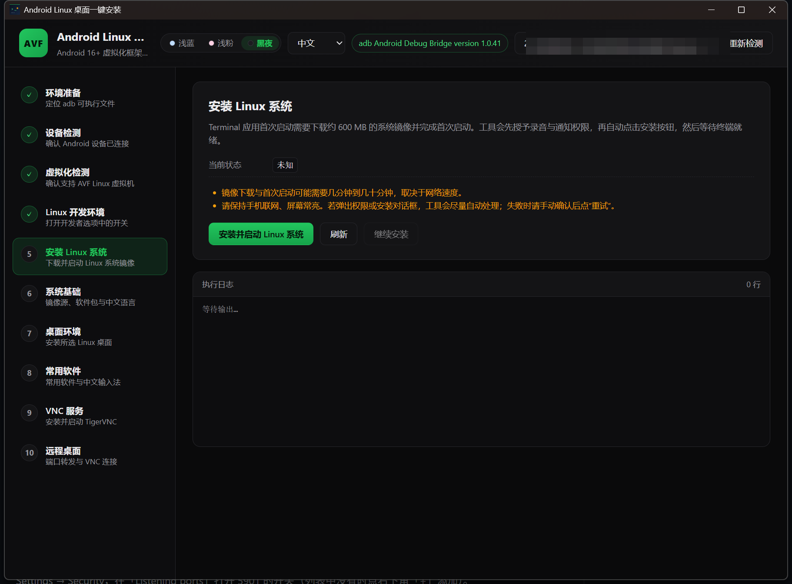
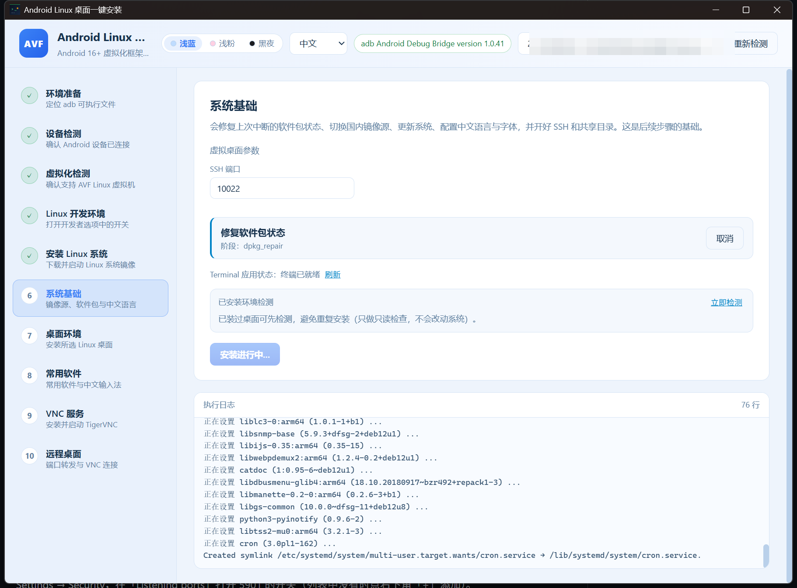

# AndroidCreateLinuxGUITool

在支持 **AVF（Android 虚拟化框架）的 Android 16+ 手机**上一键装好 Debian 桌面环境，
并用 Windows 图形界面全程遥控，不需要在手机上手动敲命令。

[English](README.md) | **简体中文**



<p align="center"><em>10 步工作流：设备检测 → Linux 虚拟机 → 系统基础 → 桌面环境 → 常用软件 → VNC 服务 → 远程桌面</em></p>



<p align="center"><em>虚拟机内的实时日志，按阶段显示进度，可随时取消或重试</em></p>

## 功能亮点

- **10 个引导步骤**：adb 检测、设备检测、AVF 检测、Linux 开发环境、系统镜像，随后是 4 个独立的安装阶段和远程桌面。
- **全自动安装**：自动打开开发者选项里的「Linux 开发环境」开关（兼容中英文系统界面），必要时自动安装 Terminal 系统镜像，并在虚拟机内执行幂等安装脚本。
- **4 个独立安装阶段**：「系统基础 / 桌面环境 / 常用软件 / VNC 服务」分开执行，某一步失败只需重跑该步骤；上次中断留下的 dpkg 异常会自动修复。
- **离线可用**：内置 adb、TigerVNC 查看器和 AVNC 安装包，网络受限时也能用。
- **7 种界面语言**（中、英、德、法、西、日、韩）与 3 套主题（浅蓝、浅粉、黑夜）。
- **真实进度回传**：脚本把标记写入共享目录的日志，PC 端通过 adb 轮询读取，无需识别屏幕。

## 工作原理

```text
Windows 图形界面 ──adb push──▶ 手机共享存储 ──virtiofs──▶ Debian 内的 /mnt/shared
        ▲                                                        │
        └──────────── adb shell cat acl_install.log ◀────────────┘
```

工具把 `install-desktop.sh` 渲染好（注入界面选项），推送到手机共享目录，再在 Terminal 应用中执行。
进度（`@@STEP:` / `@@RESULT:`）和失败原因写入 `acl_install.log`，界面据此更新，不依赖 OCR 或读屏。

## 十个步骤

| # | 步骤 | 内容 |
| --- | --- | --- |
| 1 | 环境准备 | 优先使用内置 `adb`，找不到时可手动指定 `adb.exe` |
| 2 | 设备检测 | 检测已连接且已授权 USB 调试的设备，未连接时弹窗引导 |
| 3 | 虚拟化检测 | 检查 `virtualization_framework` 与 `vm info`，不支持的机型提前提示 |
| 4 | Linux 开发环境 | 在开发者选项中自动找到并打开「Linux 开发环境」开关（中英文界面），遇到企业策略 / 安全文件夹等限制时给出说明 |
| 5 | 安装 Linux 系统 | 唤起 Terminal，按需自动安装系统镜像（约 600 MB），并授予录音、通知权限 |
| 6 | 系统基础 | 修复 dpkg 中断状态、切换国内镜像源（可选）、`apt update/upgrade`、中文语言与中文字体、SSH（10022）、挂载共享目录 |
| 7 | 桌面环境 | 安装所选桌面：XFCE（默认）、GNOME、KDE Plasma、MATE、Cinnamon、LXQt、LXDE、GNOME Flashback |
| 8 | 常用软件 | 可选安装常用软件套件与 Fcitx5 中文输入法 |
| 9 | VNC 服务 | 安装配置 TigerVNC、生成密码文件、启动 `:1` 会话（端口 5901），并校验窗口管理器确实接管 |
| 10 | 远程桌面 | 放行 5901 端口（Terminal → ⋮ → Settings → Security）、`adb forward`、打开 TigerVNC；可为手机安装 AVNC |

第 6–9 步就是原来单一的「安装桌面环境」，拆开之后每一步都更短、可单独重跑、也更容易定位问题。

## 环境要求

- Windows 10/11
- 不需要单独安装 Android Platform Tools：工具内置 `adb`，也可指定自己的 `adb.exe`
- 手机：Android 16+，支持 AVF，已开启 USB 调试
- 安装时手机需保持**亮屏、解锁**：自动输入依赖软键盘，锁屏会让输入被系统丢弃
- 手机至少预留约 2 GB 存储空间

## 快速开始

1. 连接手机并解锁，确认 USB 调试已开启。
2. 运行发布版：

   ```text
   src-tauri\target\release\android-create-linux-gui-tool.exe
   ```

3. 按左侧步骤依次操作，每一步完成后自动解锁下一步。

第 6 步会询问是否为中国用户：选「是」切换清华 TUNA 镜像源并启用中文语言与输入法；选「否」使用 Debian 官方源与英文环境。

### 第 6–9 步说明

- 每个阶段都是幂等的；中途取消后再次点击安装，会从同一阶段继续。
- 安装前会先做只读检测，显示已安装的**桌面环境 / 常用软件 / 中文输入法 / TigerVNC / SSH**，已完成的阶段可以跳过。
- 默认参数：VNC 密码 `linux`，显示号 `:1`（端口 `5901`），分辨率 `1920x1080`，SSH 端口 `10022`。

### 第 10 步说明

- 「放行端口并打开 TigerVNC」会依次完成端口放行、`adb forward tcp:5901`、启动内置查看器并填入地址与密码。
- 「安装 AVNC」优先使用内置 APK，失败才回退到 GitHub 下载；连接参数为 `127.0.0.1:5901` 与第 9 步设置的 VNC 密码（用户名可留空，填 `droid` 亦可）。

## 从源码构建

前置：Node.js 18+、Rust（stable）、WebView2（Win10/11 自带）、MSVC 生成工具与 Windows SDK。

```bash
npm install

# 开发模式（热更新）
npm run tauri:dev

# 发布构建
npm run build
cd src-tauri
cargo build --release --features custom-protocol
```

产物位于 `src-tauri/target/release/android-create-linux-gui-tool.exe`。

## 命令行参数

| 参数 | 作用 |
| --- | --- |
| `--diagnose` / `--diagnose-json` | 输出设备、AVF、开发者选项的检测报告 |
| `--selftest` | 在真机上跑一遍核心链路 |
| `--install` | 无界面执行安装 |
| `--stage=base\|desktop\|apps\|vncsvc` | 配合 `--install` 只执行某一个安装阶段 |
| `--desktop=xfce` | 配合 `--install` 指定桌面环境 |
| `--official-source` | 配合 `--install` 使用官方源与英文环境 |
| `--no-apps` | 配合 `--install` 跳过常用软件套件 |
| `--fetch-viewer` | 只下载免安装版 TigerVNC Viewer |
| `--port=5901` | 放行端口 + `adb forward` + 尝试打开 TigerVNC |
| `--exec="<命令>"` | 在虚拟机终端执行一条命令并取回输出 |

```powershell
.\android-create-linux-gui-tool.exe --diagnose
.\android-create-linux-gui-tool.exe --install --stage=base
.\android-create-linux-gui-tool.exe --exec="uname -a"
```

## 项目结构

```text
├─ src/                        # 前端（Vue 3）
│  ├─ App.vue                  # 10 步工作流主界面
│  ├─ api.ts                   # Tauri command / 事件封装
│  ├─ i18n.ts                  # 7 种界面语言
│  ├─ types.ts                 # 前后端共享类型
│  └─ components/              # 日志面板、模态弹窗
├─ src-tauri/
│  ├─ src/
│  │  ├─ adb.rs                # adb 封装（定位、shell、push、forward）
│  │  ├─ detect.rs             # 设备与 AVF 检测
│  │  ├─ devopts.rs            # 开发者选项 / Linux 开发环境开关
│  │  ├─ terminal.rs           # 驱动 Terminal 应用（聚焦、输入、点击）
│  │  ├─ installer.rs          # 分阶段安装编排与日志轮询
│  │  ├─ ports.rs              # VNC 端口放行
│  │  ├─ vnc.rs                # TigerVNC 启动、AVNC 安装、adb forward
│  │  ├─ commands.rs           # 暴露给前端的 Tauri 命令
│  │  └─ lib.rs / main.rs      # 入口与命令行模式
│  └─ resources/
│     ├─ install-desktop.sh    # 在虚拟机内执行的分阶段安装脚本
│     ├─ detect-installed.sh   # 只读环境检测脚本
│     ├─ adb.exe               # 内置 adb
│     ├─ vncviewer.exe         # 内置 TigerVNC 查看器
│     └─ avnc.apk              # 内置 Android VNC 客户端
├─ docs/images/                # README 截图
└─ shots/                      # 截图辅助脚本
```

## 常见问题

**一直提示「命令似乎没有在终端中执行，正在重新聚焦后重试」**
自动输入依赖软键盘。请保持手机亮屏解锁，必要时手动点一下 Terminal 的命令行区域再重试。

**VNC 连上了但桌面黑屏**
脚本已通过 `~/.xsessionrc` 强制 X11。可在终端执行 `bash /mnt/shared/acl_install.sh vncsvc` 重跑，残留的窗口管理器会话会被自动清理。

**安装卡在「Package configuration」**
旧版本可能因 debconf 交互而停滞。当前版本通过 sudo 透传 `DEBIAN_FRONTEND=noninteractive` 并预置 keyboard-configuration 答案，请使用最新构建。

**端口转发失败**
重新插拔 USB 并确认 `adb devices` 正常；也可手动放行：Terminal → 右上角 ⋮ → Settings → Security → Listening ports，列表中若没有 5901 可点「+」添加。

**设备被误报为「企业管理设备」**
部分 HyperOS/MIUI 输出小写的 `no owners`，新版本已按大小写不敏感匹配。

## 免责声明

本工具会通过 adb 修改开发者选项并重启虚拟机内的服务，请在了解风险的前提下使用；
安装会占用约 2 GB 以上手机存储，并需要较长时间下载依赖包。
